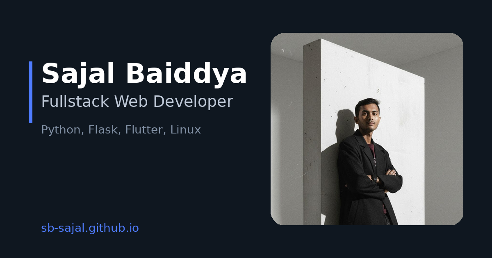

# Sajal Baiddya (Rafael)

**Fullstack web developer** building fast, clean web and mobile products.

[**sb-sajal.github.io**](https://sb-sajal.github.io)

## About

I work with **Python, Flask, JavaScript and Flutter**, mostly on Linux. I like turning rough ideas into software people can actually use: web apps, mobile apps and automation.

## Selected work

- **Galvagni Centre**: website with a CMS and admin security
- **Telegram Mega-Bot**: plugin-based Telegram bot
- **Flutter apps**: Android apps with Material 3

## This site

Plain HTML, CSS and JavaScript. No frameworks, no build step. Light and dark themes, fully responsive and keyboard accessible. First-time visitors watch AI agents build the page live (replay with `?intro=1`).

## Contact

[GitHub](https://github.com/sb-sajal) · [X](https://x.com/sb0369) · [Telegram](https://t.me/sauran369) · [Email](mailto:sbsajal0369@gmail.com)
